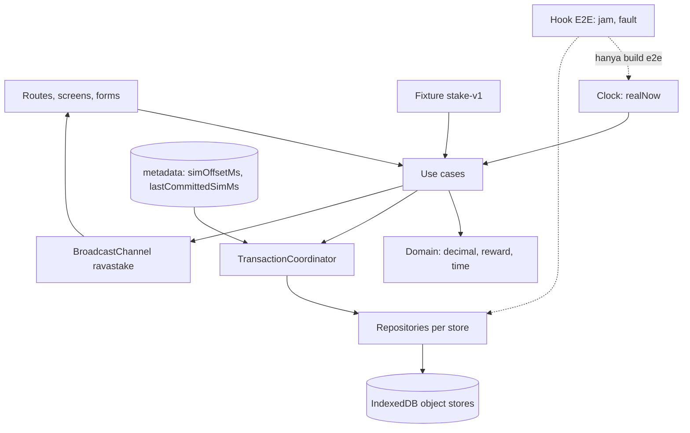

# Architecture — RavaStake

Status: disetujui 2026-10-07; implementasi M1 mengikuti struktur ini.

## Batas sistem

SPA statis React/TypeScript memakai data pasar bawaan dan IndexedDB per origin. UI tidak berbicara ke blockchain atau backend. Seluruh posisi, saldo, ledger, watchlist, dan waktu simulasi adalah state demo lokal. Deploy ke Vercel hanya menyajikan file statis.



## Modul

- `app`: routing, layout, error boundary, badge waktu, kontrol waktu, sync antar-tab.
- `features/*`: dashboard, assets, calculator, positions, activity, settings.
- `domain`: types, decimal parsing, validation, reward/valuation formula, waktu simulasi, formatter.
- `data`:
  - `db.ts` — schema, open, upgrade, `onversionchange`/`blocked`;
  - `coordinator.ts` — satu-satunya pemanggil `db.transaction()`;
  - `repositories/*` — satu per store, setiap method menerima handle transaksi;
  - `useCases.ts` — draft CRUD, activate, close, advanceTime, reset, watchlist;
  - `queries.ts` — saldo, daftar, X-ray;
  - `fixture.ts` — `stake-v1`;
  - `faults.ts` — titik fault injection.
- `shared`: design tokens, UI primitives, accessibility.

### Kontrak transaksi

Hanya `TransactionCoordinator` (dan `db.ts` untuk transaksi `versionchange`) yang boleh memanggil `db.transaction()`. Repository tidak pernah membuka transaksi; setiap method menerima handle transaksi dari coordinator. Tes statis di unit suite gagal kalau `.transaction(` muncul di file lain di `src/`. Kalau callback use case melempar error, coordinator memanggil `tx.abort()` sehingga tidak ada tulisan parsial.

## Alur activation

```text
UI (operationId, expectedOffsetMs, preview principal/APR)
  └─ coordinator.write([positions, providers, ledger, operations, activity, metadata])
       ├─ operations.get(operationId) ── ada ──▶ kembalikan hasil lama (replay sukses)
       ├─ metadata: offset ≠ expected ──▶ stale-time (abort)
       ├─ asOf = max(lastCommittedSimMs, realNow + offset)
       ├─ position harus draft ── bukan ──▶ invalid-transition
       ├─ provider APR / principal ≠ preview ──▶ stale-draft
       ├─ Σ ledger(asset) < principal ──▶ insufficient-balance
       └─ tulis: position active + reserve −principal + operation + activity + lastCommittedSimMs
```

Close memakai scope yang sama: replay, cek offset, status harus active, hitung elapsed/reward dari `asOf` yang dicapture sekali, bandingkan dengan preview, credit return + reward, ubah status closed dengan snapshot, tulis activity. Dua tab tidak dapat mengaktifkan draft atau menutup posisi dua kali.

## Alur majukan waktu

```text
UI (operationId, N hari, expectedOffsetMs)
  └─ coordinator.write([metadata, operations, activity])
       ├─ replay ──▶ hasil lama
       ├─ offset ≠ expected ──▶ stale-time
       └─ offset += N hari; asOf = max(last, realNow + offset); tulis metadata, operation, activity
  └─ broadcast "invalidate" ──▶ tab lain memuat ulang badge, estimasi, dialog
```

## Concurrency dan lintas tab

IndexedDB readwrite transaction dengan store scope yang sama menjadi otoritas serialisasi. Setelah setiap commit, tab pengirim mem-broadcast `invalidate` lewat BroadcastChannel `ravastake`; fallback refetch saat focus. Sinyal ini bukan pengganti validasi di database. Reset bertransaksi pada seluruh store aplikasi agar tidak meninggalkan sebagian state. Dialog yang targetnya hilang karena reset di tab lain menutup diri dengan pesan "Data sudah direset di tab lain".

Jangan menunggu fetch, timer, atau operasi eksternal selama transaksi IndexedDB karena transaksi dapat menjadi inactive. Perhitungan murni dan request database saja berada dalam boundary tersebut.

## Persistensi dan pemulihan

Metadata schema/seed version memisahkan database baru dari database invalid. Migrasi berjalan pada versionchange transaction. Koneksi menutup diri saat `versionchange` dari tab lain dan menampilkan instruksi reload; tab yang terblokir menampilkan `migration-blocked`. Jangan memaksa reset otomatis. Storage denied/quota/read error menampilkan masalah dan retry. Reset destruktif hanya lewat konfirmasi pengguna.

Saat IndexedDB tidak tersedia, tampilkan recovery state tanpa berpura-pura perubahan tersimpan. Sinkronisasi server dan backup bukan bagian MVP.

## Test seam

Build mode `e2e` memasang `window.__ravastakeTest` sebelum aplikasi boot:
- `setNow(ms)` dan `advanceNow(ms)` untuk jam nyata;
- `failNextWrite(store)` untuk fault injection di repository asli.

Konfigurasi awal dibaca dari `window.__ravastakeTestConfig` yang dipasang Playwright lewat `addInitScript`. Build production tidak mengimpor modul hook; tes statis memastikan string `__ravastakeTest` tidak ada di `dist/`. Production E2E memakai waktu nyata dan memajukan waktu lewat UI mesin waktu.

Unit menguji rumus/validasi, browser integration menguji IndexedDB dengan jam yang di-inject, E2E menguji UI pada build e2e dan build produksi.
