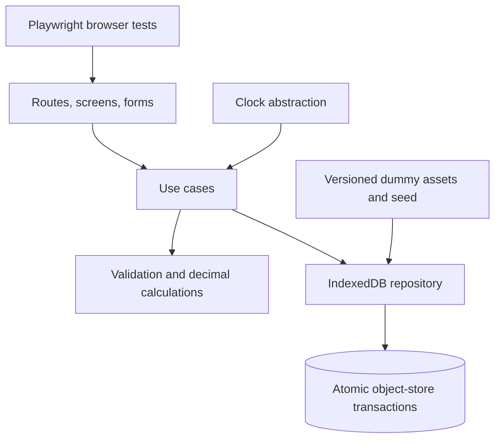

# Architecture — RavaStake

Status: rancangan, belum ada komponen yang dibuat.

## Batas sistem

SPA statis React/TypeScript memakai data pasar bawaan dan IndexedDB per origin. UI tidak berbicara ke blockchain atau backend. Seluruh posisi, saldo, ledger, dan watchlist adalah state demo lokal.

## Modul

- `app`: routing, providers, error boundary, layout.
- `assets`: search/filter/sort, watchlist, chart fixture.
- `calculator`: pure estimasi simple interest; tidak melakukan write saldo.
- `positions`: draft CRUD, activation, active/closed view, close simulation.
- `activity`: history query dan filter, tanpa mutation histori.
- `domain`: types, decimal parsing, validation, reward/valuation formula.
- `data`: object stores, schema migrations, seed, repositories, transaction coordinator.
- `shared`: design tokens, UI primitives, formatters, accessibility.

## Alur activation

Satu operation ID dibuat untuk aksi pengguna dan digunakan kembali bila retry. Dalam satu readwrite transaction meliputi positions, ledger, operations, activity: baca draft + saldo terbaru, cek operation ID, validasi, snapshot APR/harga/durasi, ubah draft menjadi active, tulis reserve principal dan activity, lalu commit. UI mengubah state setelah transaksi complete.

Close memakai scope transaksi yang sama: cek status dan operation ID, hitung reward dari clock yang dicapture sekali, credit principal/reward, ubah status closed, tulis activity, commit. Dua tab tidak boleh mengaktifkan draft atau menutup posisi dua kali.

## Concurrency dan lintas tab

IndexedDB readwrite transaction dengan store scope yang sama menjadi otoritas serialisasi. BroadcastChannel dapat memberi notifikasi invalidation ke tab lain; fallback refetch pada focus. Sinyal ini bukan pengganti validasi di database. Reset bertransaksi pada seluruh store aplikasi agar tidak meninggalkan sebagian state.

Jangan menunggu fetch, timer, atau operasi eksternal selama transaksi IndexedDB karena transaksi dapat menjadi inactive. Perhitungan murni dan request database saja berada dalam boundary tersebut.

## Persistensi dan pemulihan

Metadata schema/seed version memisahkan database baru dari database invalid. Migrasi berjalan pada versionchange transaction. Tab yang menghalangi upgrade menerima instruksi tutup/reload; jangan memaksa reset otomatis. Storage denied/quota/read error menampilkan masalah dan retry. Reset destruktif hanya lewat konfirmasi pengguna.

Saat IndexedDB tidak tersedia, tampilkan recovery state tanpa berpura-pura perubahan tersimpan. Sinkronisasi server dan backup bukan bagian MVP.

## Test seam

Clock dan fixture loader dapat dikontrol pada build E2E; production memakai waktu aktual serta fixture bawaan. Fault injection menargetkan repository asli. Unit menguji rumus/validasi, browser integration menguji IndexedDB, E2E menguji UI di dev dan build produksi. Test hooks tidak masuk artifact publik.
