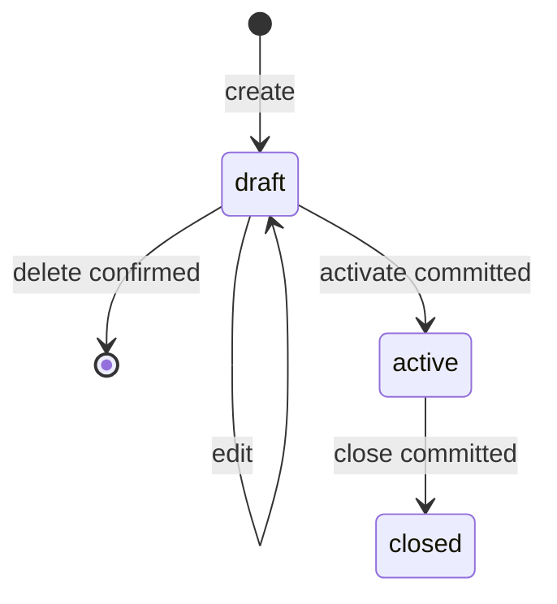

# Data model & fixtures — RavaStake

Status: kontrak schema v1 untuk implementasi dan pengujian (disetujui 2026-10-07).

## Object stores

Database `ravastake`, versi 1.

| Store | Key / index | Field dan constraint |
|---|---|---|
| assets | key `id`; index `symbol` unik | `id`, `symbol`, `name`, `priceUsdCents`, `chart7d`, `chart30d`; read-only fixture, harga positif. Titik terakhir `chart7d`/`chart30d` sama dengan `priceUsdCents`. |
| providers | key `id`; index `assetId` | `id`, `name`, `assetId`, `aprBps`; provider fiktif, APR fixture tetap. |
| watchlist | key `assetId` | `assetId`, `addedAtMs`; tidak duplikat. |
| positions | key `id`; index `status`, `assetId` | `id`, `assetId`, `providerId`, `principalUnits`, `durationDays`, `note`, `status` (draft/active/closed), `createdAtMs`, `updatedAtMs`; saat active tambahkan `aprBpsSnapshot`, `activatedAtMs`; saat closed tambahkan `closedAtMs`, `elapsedDaysSnapshot`, `rewardUnitsSnapshot`. |
| ledger | key `id`; index `assetId`, `positionId`; index unik `opKindAsset` = `[operationId, kind, assetId]` | `id`, `operationId`, `assetId`, `positionId?`, `kind` seed/reserve/return/reward, `deltaUnits`, `createdAtMs`; immutable. |
| operations | key `operationId` | `operationId`, `kind` (seed/activate/close/time-advance), `positionId?`, `resultSnapshot`, `createdAtMs`; satu entry per aksi committed. |
| activity | key `id`; index `createdAtMs` | `id`, `operationId`, `positionId?`, `kind` activate/close/time-advance, `payload`, `createdAtMs`; immutable. |
| metadata | key `key` (satu record `meta`) | `schemaVersion`, `seedVersion`, `seededAtMs`, `simOffsetMs`, `lastCommittedSimMs`, `timeTravelAcknowledged`. |

Satu operasi close menghasilkan dua ledger entries (return dan reward) dengan ID berbeda; index unik `[operationId, kind, assetId]` mencegah debit/credit ganda per jenis per aset, termasuk seed yang membuat satu grant per aset dalam satu operasi. Semua hubungan asset/provider/position divalidasi repository karena IndexedDB tidak menyediakan foreign keys SQL. Field opsional dihilangkan (bukan `null`) agar tidak masuk index.

`timeTravelAcknowledged` menjadi `true` setelah lompatan waktu pertama; dialog penjelasan "waktu hanya bisa maju" hanya muncul sampai saat itu (dan muncul lagi setelah reset).

## State machine

Aktivasi gagal mempertahankan draft; close gagal mempertahankan active. Closed menyimpan histori dan tidak dibuka ulang. Reset demo menghapus semua store melalui satu transaksi, kemudian memasukkan fixture konsisten dengan offset waktu 0.

## Fixture `stake-v1`

Gunakan waktu referensi `T0 = 2026-10-01T00:00:00Z` untuk tes. Seed menggeser waktu posisi contoh relatif waktu pembuatan database (atau waktu reset), sedangkan nilai/ID tetap.

| Aset | Harga USD dummy | Provider / APR | Opening balance | Posisi seed | Saldo tersedia awal |
|---|---|---|---|---|---|
| ETH | $2.000 (200000 cents) | `provider-eth-demo` / 500 bps | 2 ETH | Tidak ada | 2 ETH |
| SOL | $100 (10000 cents) | `provider-sol-demo` / 700 bps | 50 SOL | `position-sol-seed`: 10 SOL, mulai T0−30 hari, durasi 90 hari | 40 SOL |
| AVAX | $25 (2500 cents) | `provider-avax-demo` / 600 bps | 100 AVAX | Tidak ada | 100 AVAX |

Operasi seed:
- `seed-stake-v1-grants` (kind `seed`): satu ledger `seed` per aset.
- `seed-stake-v1-sol` (kind `activate`): position SOL, ledger `reserve` −10 SOL, dan activity.

Seed tidak diulang pada reload. Watchlist kosong; draft dan closed kosong. Grafik berisi urutan data sintetis tetap: 7 dan 30 observasi harian, tanpa random pada setiap render.

## Oracle numerik untuk pengujian

1. Buat draft 1 ETH, 365 hari. Draft tidak mengubah saldo tersedia 2 ETH.
2. Aktifkan pada T0: reserve −100000000 units; saldo tersedia 1 ETH; principal aktif baru 1 ETH.
3. Pada T0+73 hari, reward = 100000000 × 500 × 73 / 3650000 = 1000000 units = 0,01 ETH.
4. Tutup pada waktu tersebut: ledger return +1 ETH dan reward +0,01 ETH; saldo tersedia akhir 2,01 ETH. Detail closed tetap menampilkan reward itu walau clock maju lagi.
5. Close ulang tidak mengubah saldo, ledger, atau aktivitas.
6. Kalkulator 1 ETH, 5%, 365 hari menghasilkan 0,05 ETH; 73 hari menghasilkan 0,01 ETH; APR 0 menghasilkan 0. Kalkulator tidak melakukan write.
7. Untuk seed SOL pada T0: reward floor(1000000000 × 700 × 30 / 3650000) = 5753424 units = 0,05753424 SOL. Nilai ini belum masuk saldo tersedia.
8. Dua draft ETH masing-masing 1,5 ETH diaktifkan bersamaan dengan opening 2 ETH: tepat satu sukses; saldo tersedia 0,5 ETH; draft lain tetap draft.
9. Mesin waktu: aktifkan 1 ETH pada T0, majukan 73 hari lewat UI → `simOffsetMs = 6307200000`, estimasi 0,01 ETH; tutup → saldo 2,01 ETH. Majukan +30 hari dari offset 0 pada 1 ETH aktif → estimasi 410958 units = 0,00410958 ETH.
10. Dua tab memajukan +30 hari dari offset 0 bersamaan → tepat satu sukses, offset akhir 2592000000, tab lain `stale-time`.

## Validasi schema dan migrasi

Principal/delta/reward units berupa string integer kanonik (delta boleh negatif); field nominal lain mengikuti batas pada TRD. Note maksimal 200 karakter setelah trim. Posisi tanpa asset/provider valid, ID ganda, status tak dikenal, atau schema versi masa depan ditolak tanpa reset otomatis.

Migrasi versionchange harus diuji dengan fixture schema sebelumnya ketika v2 dibuat. Pada v1, uji database baru, invalid data, upgrade blocked, dan versi unsupported. Snapshot pada activity/operations tidak dianggap sumber saldo; ledger adalah sumbernya.
